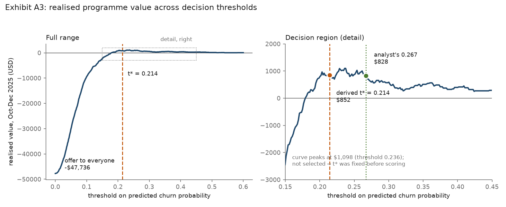
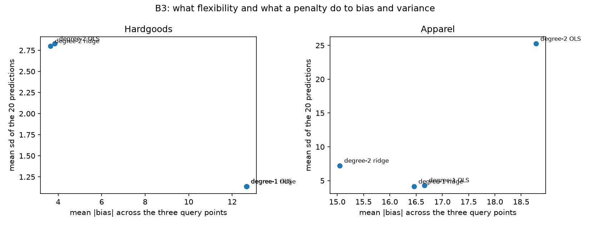

# Memo

**From:** Orcun Tasdemir
**Date:** 2 October 2026
**Re:** §1 Northline Fitness retention targeting · §2 Cascade Outdoor forecasting standard

Every figure is reproduced by `bash analysis/run.sh`; the output
file for each is named in the exhibits.

---

# §1: To the VP of Membership, Northline Fitness

## My Recommendation

**Run the retention program on non-corporate members only for the time being, and instrument it so that it can be stopped on a defined trigger.** On the most recent quarter it would have returned **$852**, not the $19,774 per quarter you saw in the initial analyst's brief. Excluding
corporate raises that to **$930**, for two reasons. The first is its realised performance: corporate offers reached a member who was going to cancel 11% of the time against the 21.4% needed to break even, though that is nine offers and so cannot carry the decision on its own. The second is structural and is the one I would rely on: the model ranks corporate members at 0.404, below a coin flip, on 860 rows, and it was fitted on only 533 corporate member-months with no tenure beyond six months, so it has no corporate-specific signal to rank with. Corporate is also forecast to grow from 19% of the book to 35%, so it makes more sense to wait until there is enough history to fit on. Measure **realised value per offer** on matured 60-day outcomes each quarter and suspend the program if it turns negative, which is the same as the share of offers reaching a churner falling below 21.4%, the specific cost-based threshold calculated from the provided financial numbers.

## What would have to be true for 0.967 to describe April 2026

The pipeline itself is careful: the encoder and the scaler are fitted inside
each fold, so there is no preprocessing leak. What 0.967 rests on sits above the
modelling, and two quite separate things would both have to hold.

**It would have to be an honest estimate of 2024 and 2025 at all.** That
requires every column the model uses to have been knowable at the start of the
month being scored, and it requires that predicting a member's month from that
same member's other months, including later ones, counts as prediction. Neither
is the case, and Exhibit A2 prices each failure separately.

**And an honest 2024–25 number would still have to transfer to April.** That
requires the book to be roughly the same book. It is not: corporate members were
0% of 2024 rows and are forecast at 35% of the April–June 2026 book, a
competitor has been spending since July 2025, and the monthly cancellation rate
ranged from 5.3% to 14.2% across the two years.

The distinction matters because only the first is fixable. Protocol repairs it,
which is what Exhibit A2's four corrections do, one at a time so that each row
differs from the one above by exactly one change. The second cannot be repaired,
only measured, which is what reporting by segment is for.

Exhibit A1 sets the scale first, because 0.967 means nothing on its own. AUC
measures one thing: whether the model ranks members who cancel above members
who do not. A coin flip scores 0.50 and a flawless ranking scores 1.00. It takes
no account of how many offers you send or what they cost, which is why the
decision itself is priced in dollars further down. On that scale, ranking
members by a single behavioural column with no model at all reaches 0.68.

Predicting "no churn" for everyone, meanwhile, is 90.7% accurate and identifies
nobody; that same rule scores 0.50 on the AUC scale, so 90.7% and 0.967 are not
neighbouring numbers and should never be compared. Accuracy is the wrong
yardstick twice over: the outcome is rare, so the figure is dominated by the 91%
of rows where nothing happens; and a wasted offer costs $18 against $66 forgone
on a missed churner, so counting both as one mistake prices them wrongly. What
this decision needs is a loss function denominated in dollars.

**Two of the fourteen columns do not exist at the moment a score has to be produced.** The program scores the book at the *start* of each month and `winback_offer_sent`
records a contact worked from a list circulated on the third business day
*after* month close; similarly `exit_survey_started` records a member opening the
cancellation survey, which is a step in cancelling itself. In the historical file both
are filled in. The exit-survey variable is 1 on 1,810 rows and **every one is a
cancellation** with no exceptions in 31,645 rows. On 1 April both will be 0
for everyone, including the members who go on to leave. Removing them costs
0.22 AUC but makes the model honest and more in line with its purpose. Exhibit A2b discusses, using the data dictionary, the reason for each column kept and each column dropped.
**Keeping a member wholly on one side of the split costs 0.001**, even though
2,899 of 3,648 members had rows in more than one fold beforehand.
**Fitting on the past and scoring the future costs another 0.10**; it is not enough for the scored data to be unseen, which it already was, it also has to be *later*. The two-month gap exists because a June 2025 label is not
settled until 31 August, so training on June while evaluating in July would use
outcomes from the period being evaluated. It also mirrors deployment: on 1 April 2026 the two most recent months of labels will not exist either, because a February row's 60-day window does not close until the end of April. In production the freshest usable labels are always about two months old, and the gap reproduces that rather than handicapping the evaluation.

**These differences are not a clean decomposition.** Each is measured on top of those
above it, so they sum to the total but the split for how much AUC is lost depends on the order the improvements are made. Had
past-to-future come first with the two post-hoc columns still in, the test AUC
would have stayed near 0.97, the temporal split would have looked free, and dropping the columns afterwards would have carried the whole fall.

## From a probability to a decision

An offer to a member who would have cancelled is worth 240 × 0.35 − 18 = **$66**;
to one who would not, it costs **$18**; no offer is worth $0. So at predicted
probability *p* the expected value of offering is

> 66*p* − 18(1 − *p*) = **84*p* − 18**

which beats not offering exactly when **p > 18/84 = 0.2143**. That comes from
our finance figures alone, and was decided before any test-period score was
read. The analyst's 0.267 was instead found by searching 400 cut-points for the
one that maximised measured value, which is choosing by looking at the answer. It made little difference: on honest scores his cut-point returns $828 against our $852. The $19,774 was never a threshold error.

0.2143 is also the **break-even precision**, meaning the share of offers that
have to reach someone who would genuinely have cancelled: value per offer is
exactly 84 × (precision − 0.2143), so below 21.43% the program loses money and
above it the program makes money. Against a 9% base rate, clearing that bar means finding members at roughly two
and a half times average risk. The model manages it: the 242 offers it selects
are about 5% of the book, and 25.6% of them reach someone who cancelled, four
percentage points above break-even.

## What it is worth

On the test quarter, $852, against **−$47,736** for offering to every
member-month and $0 for doing nothing: targeting is what makes the program
viable at all.
But the total carries a standard error of about **$572**. Each offer returns
either +$66 or −$18, so the quarter is a sum of 242 such draws, and that spread
is what the arithmetic gives. $852 is therefore only 1.5 standard errors above
zero: run the same program on another similar quarter and a result anywhere
either side of break-even would be unremarkable. The three months bear that
out at the same fixed threshold, November +$810, October +$48, December −$6, so
one month carried almost all of it. Excluding corporate does not fix this.
Everyone else returns $930 with a standard error of $565, which is 1.65
standard errors from zero, because corporate was only 9 of the 242 offers.
This is a program worth running and worth watching, not a reliable earner.

Corporate is the clearest part of the picture: an AUC of 0.404 is below a coin
flip, so inside that segment the members the model likes least are the ones who
stay. The model's largest single term is the channel itself, roughly four times
the churn odds for any non-corporate channel, so it has learned that corporate
members rarely cancel, not which of them will. Learning only that much from 533
rows none older than six months is reasonable, and it is a poor basis for
spending on a forecasted third of next spring's book. Note that the dollar
figure for corporate, −$78, carries a standard error of $84 on nine offers and
cannot carry this argument by itself; the 0.404 on 860 rows and the 533-row
training base are what do.

Two things make $852 optimistic for April: the test quarter ran 8.4–9.5% churn
where April–June 2025 ran 5.3–7.1%, and 1,294 members already received a
retention contact, so part of what we fitted to is post-treatment. The
threshold also assumes the model-outputted probabilities are actual calibrated probability values. They roughly do,
checked on September 2025 and calibrated there before use, but the model still
overstates the members it picks, claiming 39.6% for its top-scoring offers and
delivering 27.9%. This is why the tripwire is in dollars rather than AUC. If every predicted probability drifted upward tomorrow, the ranking would be untouched and AUC would not move at all, while the 21.4% cut-point would start buying offers for members who do not need them. A ranking statistic can hold perfectly steady through exactly the failure that would destroy the economics, so it is the wrong thing to watch.

---

## Exhibit A1: Baselines, before any modelling

Source: `analysis/outputs/a1_baselines.csv`, `a1_cleaning.txt`. All rows
deduplicated: the extract contains 1,695 exact duplicate rows, all in March
2025 (ticket NLF-2231), removed before every figure below except the
analyst's, which is reported as his script prints it on the raw file.

| Quantity | Value | Basis |
|---|---:|---|
| Base rate of `churn_next_60d` | **9.29%** | 2,939 of 31,645 member-months |
| *Context:* members cancelling at some point in the window | 70.0% | 2,939 of 4,200 members; a different unit |
| Accuracy of predicting "no churn" for everyone | **90.71%** | = 1 − base rate; uses no information |
| AUC of that same rule | **0.50** | every member scored alike, so no ranking |
| AUC, rank by `avg_session_minutes` (shorter → churn) | **0.681** | one column, no fitting |
| AUC, rank by `app_opens_last_30d` (fewer → churn) | 0.648 | " |
| AUC, rank by `days_since_last_login` (longer → churn) | 0.646 | " |
| AUC, rank by `tenure_months` (shorter → churn) | 0.502 | " |
| **Analyst's 5-fold cross-validated AUC, 14 columns** | **0.967** | raw 33,340 rows, randomly shuffled folds |

Tenure's 0.50 is not an artefact of a non-monotone relationship: churn sits
between 6.7% and 10.1% in every tenure bucket from month 0 to 24+
(`a1_churn_by_tenure.csv`).

## Exhibit A2: Four changes to the evaluation, one at a time

Source: `analysis/outputs/a2_table.csv`. Changes are cumulative. Rows 0–2 are
5-fold cross-validated on the building window (Jan 2024 – Jun 2025: 21,031
rows, 1,767 cancellations, 3,648 members). Rows 3–4 are the test window
(Oct – Dec 2025), scored once. The validation month (Sep 2025) is not used
here: no choice in this section was made by looking at data.

| Row | Change | Scored | Churners | AUC | Kind | What it means |
|---|---|---:|---:|---:|---|---|
| n/a | Analyst's script as printed: raw file, 24 months, 14 columns, random folds | 33,340 | | 0.967 | cross-validated | The figure in the proposal |
| 0 | Same protocol, deduplicated, building window only | 21,031 | 1,767 | **0.968** | cross-validated | Deduplication and the shorter window change nothing; the leak dominates |
| 1 | + admissible columns only (12 of 14, Exhibit A2b) | 21,031 | 1,767 | **0.748** | cross-validated | 0.22 of the headline was information recorded by the cancellation itself |
| 2 | + a member never in both the fitting and held-out folds | 21,031 | 1,767 | **0.747** | cross-validated | Worth 0.001 here: no admissible column identifies a member |
| 3 | + past to future: fit Jan 2024 – Jun 2025, score Oct – Dec 2025 | 4,556 | 408 | **0.644** | test window | 0.10 is the cost of time; rows 0–2 were already on unseen rows |
| 4 | corporate members | 860 | 34 | **0.404** | test window | Below a coin flip on the segment about to triple its share |
| 4 | everyone else | 3,696 | 374 | **0.641** | test window | Which is also the pooled figure: corporate is 19% of rows, 8% of churners |

Re-running the analyst's exact protocol on the raw file in our harness
reproduces 0.967, so the rows below are measured the same way his headline was
and the differences come from the protocol rather than from our code
(`run.log`).

**On row 2, which moves almost nothing.** The risk it guards against is real: a
member merely *having* a later row proves they had not cancelled earlier, so a
model that sees the same person on both sides can learn from whether someone
shows up again in later months rather than from what they actually did. It costs
almost nothing here because no admissible column identifies a member, and a
linear model cannot build an identity out of attributes that thousands of people
share. A more flexible model would have shown a larger drop at this row, so the
change was still the right one to make.

### Exhibit A2b: Which columns exist at the moment of scoring

Source: `analysis/outputs/a2_columns.csv`. The scoring moment is the **start**
of `snapshot_month`. Decided from the data dictionary's timing note for each
column, for columns kept as well as dropped.

| Decision | Columns | Timing note that decides it |
|---|---|---|
| **Kept (12)** | `tenure_months` | "as of the start of `snapshot_month`", so explicitly at the scoring moment |
| | `sessions_last_30d`, `app_opens_last_30d`, `avg_session_minutes`, `days_since_last_login`, `support_tickets_last_30d`, `referrals_made` | 30 days ending on the last day of the **previous** month: the window closes before the month starts |
| | `payment_failures_last_90d` | 90 days ending on the last day of the previous month |
| | `acquisition_channel`, `city_tier` | fixed at signup |
| | `plan_tier`, `monthly_price` | billing, no timing note stated. Read as the plan on the billing snapshot at the start of the month. A mid-month change would not be visible, which the dictionary does not rule out. This is the one reading rather than a fact. |
| **Dropped (2)** | `winback_offer_sent` | contact "about this month", worked from a list circulated on the third business day **after** month close. 1 on 3,533 rows, 2,239 of them cancellations |
| | `exit_survey_started` | the cancellation flow itself; no window stated. 1 on 1,810 rows, **every one a cancellation**, none a non-churner |
| **Not features (3)** | `member_id`, `snapshot_month`, `signup_month` | identifier; the month itself (April 2026 is a value never seen in training); redundant with tenure |

*One note for your analytics team.* The dictionary defines `churn_next_60d` as
termination within 60 days of the end of the snapshot month, but in the extract
the flag sits on exactly one row per member, the month they actually cancel, and
never on the one or two months before. The two-month gap in the protocol above
is therefore required under the documented definition and merely conservative
under the delivered one, so the evaluation is safe either way; the dictionary is
worth correcting before anyone else builds on this extract.

## Exhibit A3: The targeting decision

Source: `analysis/outputs/a3_value.csv`, `a3_threshold.txt`, `a3_by_month.csv`,
`a3_offer_quality.csv`. Test window Oct – Dec 2025. One offer = one
member-month, matching a programme that scores the book monthly.

**(a) Realised value at the cost-derived threshold t\* = 0.2143**

| Policy | Offers | Reached a churner | Wasted | Value | SE | SEs from 0 |
|---|---:|---:|---:|---:|---:|---:|
| **Targeted at t\* = 0.2143** | 242 | 62 | 180 | **+$852** | $572 | 1.49 |
| of which corporate | 9 | 1 | 8 | **−$78** | $84 | −0.93 |
| of which everyone else | 233 | 61 | 172 | **+$930** | $565 | 1.65 |
| Offer to every member-month | 4,556 | 408 | 4,148 | **−$47,736** | $1,619 | −29.5 |
| No programme | 0 | n/a | n/a | $0 | n/a | n/a |
| *Memo: at the analyst's grid-searched 0.267* | 108 | 33 | 75 | +$828 | $404 | 2.05 |

Standard errors are for a sum of independent +$66 / −$18 draws; the 47 repeat
contacts make them slightly optimistic.
Contacting each member at most once in the quarter gives 195 offers worth $774;
47 of the 242 are repeat contacts, and they earn $1.66 each against $3.97 for
first contacts.

**(b) Month by month at the same fixed threshold**

| Month | Offers | Precision | Break-even | Value | Per offer |
|---|---:|---:|---:|---:|---:|
| Oct 2025 | 114 | 21.9% | 21.4% | +$48 | $0.42 |
| Nov 2025 | 81 | 33.3% | 21.4% | +$810 | $10.00 |
| Dec 2025 | 47 | 21.3% | 21.4% | −$6 | −$0.13 |

**(c) Realised value across all thresholds**

The threshold was fixed from the finance table before any score was read; the
curve is shown for sensitivity, not for selection. It peaks at $1,098 at a
threshold of 0.236, so not selecting on the test period cost $264. The
analyst had no held-out period at all, so his 0.267 was the best of 400
candidates scored on the same data he evaluated, and the best of many noisy
candidates is optimistic by construction.

---

# §2: To the VP of Merchandising Planning, Cascade Outdoor

## Recommendation

**Standardise the process, not the model.** Every division should estimate its
own noise floor from repeat observations, tune flexibility and penalty by
cross-validation on its own rows, report standard errors and break ties with
the one-standard-error rule, then score once on held-out data that selects
nothing. Applied this year that process yields the *same* specification in both
divisions, degree-2 ridge, and it is no worse than the best hand-picked choice in
Hardgoods (0.15 ± 0.22) and better by 84 ± 20 in Apparel. So one specification
does serve both; the contractor's contrary conclusion came from comparing
unpenalised fits only.

**How much of the error is unavoidable.** Statistically indistinguishable in
the two divisions: 148 units² in Hardgoods against 142 in Apparel, a difference
of 6 units² against a standard error of 14 on that difference, so 0.4
standard errors. Even at the edge of a 95% interval the floors differ by
at most 34 units², against the 183 that separates his two best figures, so the
floor cannot be what makes Apparel look harder. What differs is how much is
recoverable: 83 units² above the floor against 272. His arithmetic was sound
(Exhibit B2); his conclusions were not.

**What a penalty buys, and why that differs.** In one cell of four, and
overwhelmingly: Apparel at degree 2, where it takes cross-validated error from
618 to 330, a drop of 288 against a standard error of 55. Elsewhere it does
nothing measurable: adding the penalty moves cross-validated error by 0.01,
0.15 and 1.47 units², each smaller than its own standard error, which is to say
not at all. The separator is not division size but **terms estimated per row:
0.46 where it matters, against 0.004, 0.030 and 0.061 where it does not.**

**How firm the Apparel ordering is.** Not uniformly: its standard errors run 14
to 68 against Hardgoods' 4.6 to 6.4. Firm: degree-2 ridge beats both degree-1
cells by 82 to 84 (SEs 20 to 26), and unpenalised degree 2 is worst by 204 ± 53.
Not firm: whether to penalise at degree 1, at 1.47 ± 7.26.

## Stability, and a third division

Raising the degree is a good trade in Hardgoods, where prediction spread rises
from 1.14 units to 2.83 while distance from the truth falls from 12.65 to 3.84,
and a pure loss in Apparel, where spread rises six-fold to 25.24 and accuracy
gets worse rather than better. The penalty does nothing at degree 1 in either
division or at degree 2 in Hardgoods (2.83 → 2.80), and cuts Apparel's degree-2
spread by 71%, to 7.22.

What no standard can supply is history. Apparel's best model is **85% bias**,
293 units² against 53 of variance, and the penalty is not what put it there:
unpenalised degree 1, with no shrinkage at all, carries essentially the same
bias of 294. What the penalty did was rescue degree 2 from 475 back to where
twelve terms already sat, by trading away the variance that 197 rows could not
support. Hardgoods runs the identical specification and reaches a squared bias
of 15 on 3,000 rows, which is what the extra flexibility buys once it can be
estimated. So the remedy is more Apparel weeks, not a bigger basis and not a
heavier penalty. Your own analytics team expects Apparel to reach Hardgoods'
volume of usable history by late 2027, held back by the March platform
migration that made earlier weeks incomparable, so this is a 2027 improvement
rather than something a better model delivers next quarter.

Reporting distance from the floor also tells a division which lever it needs:
more rows lower the reducible error, but only new fields lower the floor.
Hardgoods sits 99 units² above its floor of 148, so a better forecast there
needs new measurements, not a better model.

---

## Exhibit B1: How much of the error is unavoidable

Source: `analysis/outputs/b1_noise_floor.csv`, `b1_config_check.csv`. Pooled
within-configuration variance over 45 configurations of ten repeat
observations per division; 405 degrees of freedom each.

| Division | σ̂² | Approx. SE | σ̂ (units) | Mean units |
|---|---:|---:|---:|---:|
| Hardgoods | **148.1** | ± 10.4 | 12.2 | 111.9 |
| Apparel | **142.0** | ± 10.0 | 11.9 | 111.0 |

Difference (Apparel − Hardgoods) = −6.1 with a standard error of 14.4: **0.42
standard errors, indistinguishable at this precision.**

**Reading these in business terms.** The figures are squared units because they
are mean squared errors, which is the form that lets a floor be subtracted from
a model's error. Unsquared, the unavoidable scatter is about **12 units a week
per store** against average demand of 112, so roughly 11% of the level. Ten
weeks with every recorded field identical still differ by about that much, so
no forecasting system you could buy or build will typically beat it.

| Division | Contractor's best CV MSE | Floor | Avoidable | Share that is floor |
|---|---:|---:|---:|---:|
| Hardgoods | 231 (degree 2) | 148.1 | **82.9** | 64% |
| Apparel | 414 (degree 1) | 142.0 | **272.0** | 34% |

The estimator assumes the twelve recorded fields are constant within a
configuration; verified, 0 of 12 vary in any of the 90 configurations.

This is the **average** unavoidable error over the 45 configurations your team
selected during platform validation, and it is not a constant: per-configuration
variance spans 25 to 360 in Hardgoods and 34 to 301 in Apparel, a per-week
spread of 5 to 19 units against a pooled 12.2. Whether that spread is real or an
artefact of estimating each one from ten observations cannot be resolved here;
regressing a configuration's variance on its mean gives a slope of 0.657 ± 0.410
in Hardgoods, consistent both with a constant floor and with variance growing in
proportion to demand (`b1_variance_shape.csv`).

Two consequences follow, and only one of them is a limitation. Because the
configurations were selected rather than sampled **and** the floor may vary with
where you are, the figure describes the floor where those 45 configurations sit
rather than across the whole book; it should not be used to tell a planner what
the limit is at one particular store-week. But Exhibit B2's `test MSE − σ̂²` is
unaffected, because the test MSE averages over the same 45 configurations with
the same weights that σ̂² pools over, so the two are averages over an identical
set of points and the split is exact however the floor varies.

## Exhibit B2: Four models per division, against the floor

Source: `analysis/outputs/b2_table.csv`, `b2_differences.csv`. Protocol as
prescribed: 5-fold CV on the division's own training extract, basis and scaler
fitted inside each fold, ridge tuned over the 25-value grid by lowest CV MSE,
each tuned configuration refit on all training rows, then scored **once** on
the held-out repeat-observation extract. CV MSE is the average of the five fold
MSEs; the SE is their standard deviation over √5.

| Division | Degree | Penalty | Terms | Terms/row | Tuned α | CV MSE | ± SE | Test MSE | Test − σ̂² |
|---|---:|---|---:|---:|---:|---:|---:|---:|---:|
| Hardgoods | 1 | none | 12 | 0.004 | | 336.62 | 6.42 | 398.55 | 250.44 |
| Hardgoods | 1 | ridge | 12 | 0.004 | 10.0 | 336.61 | 6.39 | 398.38 | 250.27 |
| Hardgoods | 2 | none | 90 | 0.030 | | 233.12 | 4.64 | 246.16 | 98.05 |
| Hardgoods | 2 | ridge | 90 | 0.030 | 0.316 | **232.98** | 4.79 | 247.47 | 99.36 |
| Apparel | 1 | none | 12 | 0.061 | | 413.53 | 29.84 | 363.58 | 221.54 |
| Apparel | 1 | ridge | 12 | 0.061 | 10.0 | 412.06 | 36.19 | 354.12 | 212.08 |
| Apparel | 2 | none | 90 | 0.457 | | 617.97 | 67.54 | 366.86 | 224.82 |
| Apparel | 2 | ridge | 90 | 0.457 | 3.162 | **329.80** | 14.31 | **296.19** | **154.15** |

No tuned penalty falls on an endpoint of the grid. The contractor's four
figures reproduce under this protocol: 336.62, 233.12, 413.53, 617.97 against
his 336, 231, 414, 618, all within half a standard error
(`b2_contractor_check.csv`).

*Footnote.* The CV column does not compare equally across rows. An
unpenalised cell ran cross-validation once and reports what came out; a ridge
cell ran it twenty-five times, once per candidate penalty, and reports the
lowest of the twenty-five. The smallest of several noisy numbers is below the
typical one, so the ridge figures are shaded in their own favour. The test
column, scored once, is not subject to this, and it is where Hardgoods
degree-2 ridge loses to degree-2 OLS by 1.31 having won the CV comparison by
0.15.

**What the tuned penalty actually did to the coefficients**
(`b2_shrinkage.csv`). "Shrunk by" is the reduction in the length of the fitted
coefficient vector. The last two columns show what the heaviest penalty on the
grid would have done, and what cross-validation saw it cost.

| Division | Degree | Tuned α | Shrunk by | At the grid's heaviest α | CV cost of that α |
|---|---:|---:|---:|---:|---:|
| Hardgoods | 1 | 10.0 | **0.3%** | 76.9% | +286 |
| Hardgoods | 2 | 0.316 | 4.7% | 95.5% | +147 |
| Apparel | 1 | 10.0 | 5.5% | 98.1% | +409 |
| Apparel | 2 | 3.162 | **69.3%** | 99.3% | +401 |

This is why the penalty changes nothing in three cells: it barely acts. At
Hardgoods degree 1 it shortens the coefficient vector by three parts in a
thousand. That is a choice cross-validation made rather than a limit of the
method, because the grid contained penalties that would have shrunk degree 1 by
77% and 98%, and it rejected them at a cost of 286 and 409 units². With variance
already near zero at degree 1 (1.3 units² in Hardgoods, Exhibit B3), shrinking
can only add bias, so the search settles where it does almost nothing. Where
variance is the problem, at Apparel degree 2, the same search shrinks by 69%,
which is the coefficient-side view of variance falling from 664 to 53.

**Paired differences, taken fold by fold so fold-to-fold variation cancels:**

| Division | Comparison | Difference | ± SE | SEs from zero |
|---|---|---:|---:|---:|
| Hardgoods | degree-1 OLS − degree-1 ridge | 0.01 | 0.05 | 0.1 |
| Hardgoods | degree-2 OLS − degree-2 ridge | 0.15 | 0.22 | 0.7 |
| Apparel | degree-1 OLS − degree-1 ridge | 1.47 | 7.26 | 0.2 |
| Apparel | degree-2 OLS − degree-2 ridge | **288.16** | 55.02 | **5.2** |
| Apparel | degree-1 OLS − degree-2 ridge | 83.72 | 19.98 | 4.2 |

Twelve of the twenty-five penalties tested in Hardgoods degree 2 sit within one
standard error of the best, so the exact value is not load-bearing; the
one-standard-error rule is what licenses standardising on degree-2 ridge there.

**Why terms per row is the quantity, and not division size.** Two comparisons
in the table establish it, each holding one thing still.

| Compare | Held fixed | Changed | Penalty worth |
|---|---|---|---|
| Hardgoods degree 2 against Apparel degree 2 | 90 terms | 3,000 → 197 rows | nothing → 288 |
| Apparel degree 1 against Apparel degree 2 | 197 rows | 12 → 90 terms | nothing → 288 |

The first shows the number of terms is not what decides it, since ninety terms
are worthless to penalise in one division and decisive in the other. The second
shows the number of rows is not what decides it either. Only the ratio of the
two explains both, which is why the standard fixes a method rather than a
specification: a division acquired next year with 400 rows would sit at 0.225
terms per row, between these two, and its own tuning would land somewhere of
its own.

## Exhibit B3: What flexibility and a penalty do to bias and variance

Source: `analysis/outputs/b3_stability.csv`. Twenty
bootstrap resamples per division, the supplied stability loop run as issued,
penalties held at the B2 values and not re-tuned. Each model refit on every
resample and asked for the same three configurations spanning low, middle and
high demand. "sd" is the spread of the twenty predictions; "bias" is their mean
minus the repeat-observation estimate of the truth. Spread and bias are in
units; bias² and variance are their squares, in units², which is the only
scale on which the two can be compared or added. Terms and rows per term come
from Exhibit B2 and are repeated here because they are what the last two
columns track (`b3_flexibility_ledger.csv`).

| Division | Model | Terms | Rows per term | Mean sd | Mean \|bias\| | Bias² | Variance | Bias share |
|---|---|---:|---:|---:|---:|---:|---:|---:|
| Hardgoods | degree-1 OLS | 12 | 250.0 | 1.14 | 12.65 | 224.0 | 1.3 | 99% |
| Hardgoods | degree-1 ridge | 12 | 250.0 | 1.14 | 12.66 | 223.6 | 1.3 | 99% |
| Hardgoods | degree-2 OLS | 90 | 33.3 | 2.83 | 3.84 | 16.4 | 9.1 | 64% |
| Hardgoods | degree-2 ridge | 90 | 33.3 | **2.80** | **3.64** | **15.1** | **8.9** | 63% |
| Apparel | degree-1 OLS | 12 | 16.4 | 4.33 | 16.66 | 293.6 | 19.2 | 94% |
| Apparel | degree-1 ridge | 12 | 16.4 | 4.13 | 16.46 | 282.7 | 17.5 | 94% |
| Apparel | degree-2 OLS | 90 | 2.2 | **25.24** | **18.78** | **474.9** | **664.2** | 42% |
| Apparel | degree-2 ridge | 90 | 2.2 | **7.22** | **15.05** | **292.8** | **52.9** | 85% |

The truth at each configuration is itself an average of ten weeks, so it
carries a standard error of σ̂/√10: 3.85 units in Hardgoods and 3.77 in Apparel
using the pooled floor. Because the floor varies by configuration (Exhibit B1),
the yardstick does too, and per query point it runs from 1.95 to 4.81 units
(`b1_query_yardsticks.csv`). Either way a bias of that size is
indistinguishable from zero, and Apparel's 15.05 is not. Twenty resamples give
a standard deviation roughly 16% uncertain in its own right, so 2.83 against
2.80 is not a difference.

**Two separate dials, and separating them is what makes the standard
portable.** *Flexibility governs bias, but only where there are rows to fit it.*
Twelve terms leave a squared bias of 224 in Hardgoods and 294 in Apparel; ninety
terms cut that to 16 in Hardgoods and raise it to 475 in Apparel, because at
2.2 rows per coefficient the fit is so loosely pinned that even its average is
displaced. *Terms per row governs variance*, and does so without exception:
sort the unpenalised fits by that ratio and variance runs 1.3, 9.1, 19.2, 664.2.

**Mean sd and variance are not squares of one another**, because variance is
the mean of the three squared spreads rather than the square of the mean spread.
The difference between them is exactly how unequal the three query points are:
0.0 for Hardgoods degree 1, whose three spreads are 1.02, 1.15 and 1.25, and
27.0 for Apparel degree 2, whose spreads are 18.08, 30.25 and 27.40. Squaring
before averaging is the correct order, because the decomposition holds at each
query point and is then averaged.

Neither the levels nor the orderings here are comparable with Exhibit B2's:
these are three configurations rather than 45, and each fit uses a bootstrap
resample holding about 63% distinct rows rather than the full extract. The two
even disagree about Apparel. Adding the last two columns gives degree-1 OLS
312.9 against degree-2 ridge's 345.7, the reverse of Exhibit B2, where degree-2
ridge wins the test comparison 296.19 against 363.58. That is not a
contradiction: the three query points were chosen to span the demand range
rather than to represent the 45, and resampling to 123 distinct rows penalises
a ninety-term model more than a twelve-term one. **Exhibit B2 is what says
which specification is better; Exhibit B3 says what kind of error each one
makes.** Comparisons **within** this table are sound, because they hold the
points and the fits fixed and vary only the model.
